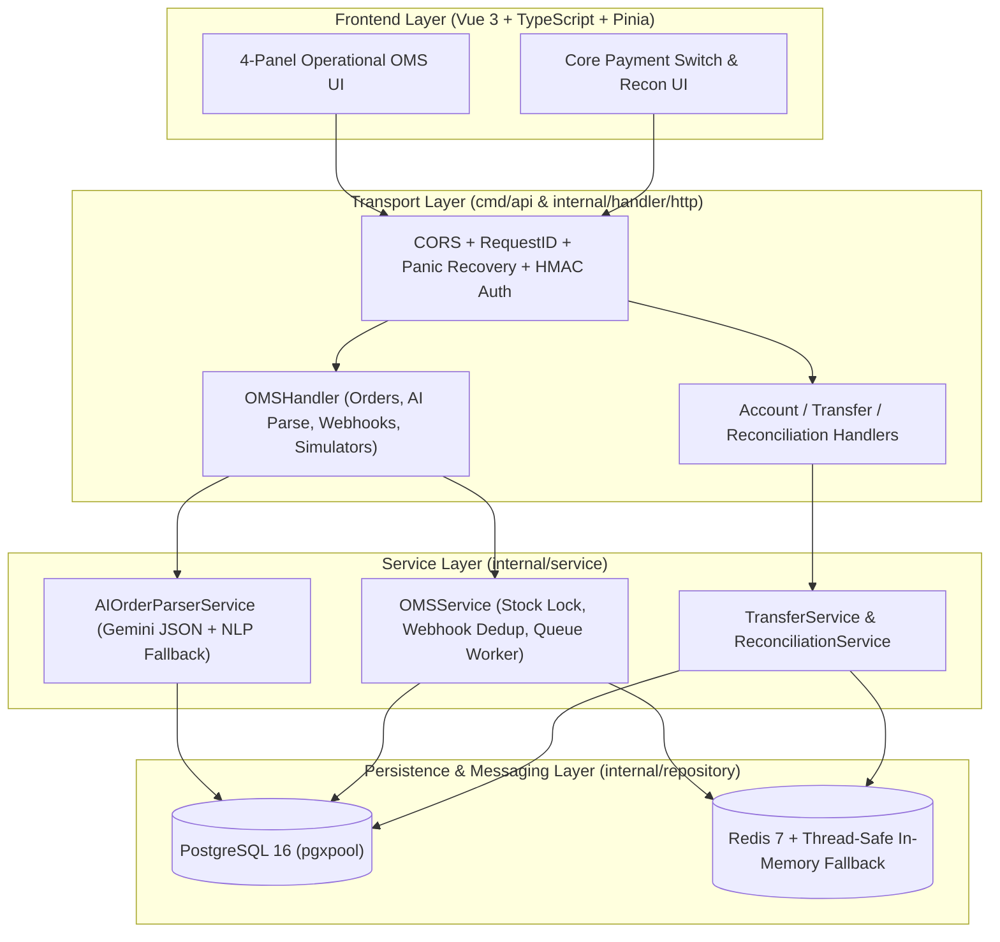
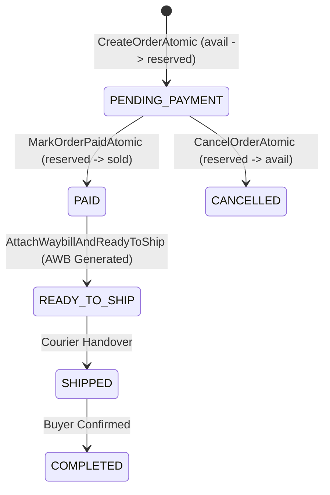
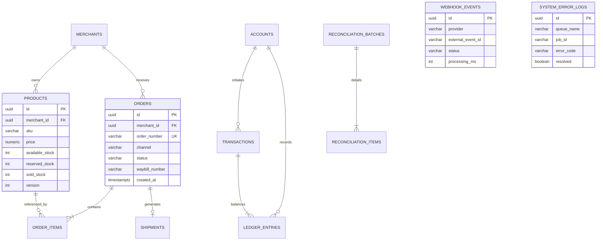
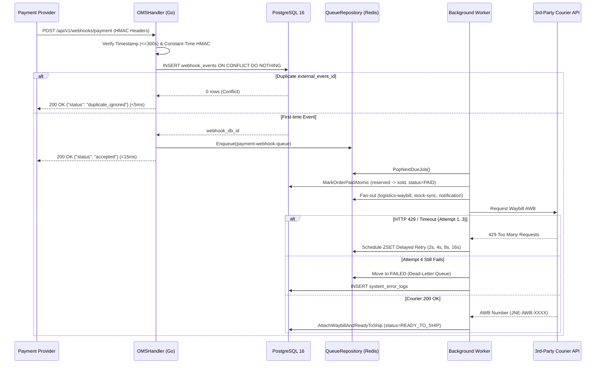

# Architecture, System Invariants & Developer Handover Guide

> **Engineering Maintenance & Onboarding Manual**  
> Dokumen ini ditulis sebagai panduan serah-terima teknis (*engineering handover*) agar developer selanjutnya dapat memahami arsitektur, batasan kritis (*system invariants*), alur data, serta prosedur pengembangan lanjutan tanpa merusak integritas stok maupun buku besar pembayaran.

---

## 1. Gambaran Umum & Bounded Contexts

Sistem ini menggabungkan dua *bounded context* utama dalam satu *monolith modular* berbahasa **Go (`chi/v5`, `pgx/v5`, `go-redis/v9`)** dengan antarmuka operasional **Vue 3 + TypeScript + Pinia**:

1. **Bounded Context A — Omni-Channel E-Commerce OMS (`oms_*`)**
   * Menangani *order capture* lintas kanal (`WEB`, `SHOPEE`, `TIKTOK_SHOP`, `WHATSAPP_LIVE`), ekstraksi chat sosial berbasis AI, manajemen inventori 3-status anti-*overselling*, penerima webhook pembayaran idempotent, serta *background worker* pencetakan nomor resi (*waybill*) dan sinkronisasi stok.
2. **Bounded Context B — Core Payment Switch & Financial Ledger (`account_*`, `transfer_*`, `reconciliation_*`)**
   * Menangani brankas akun dengan enkripsi identitas *field-level* (`AES-256-GCM`), transfer dana atomik berpasangan (*Double-Entry Bookkeeping*), rantai audit kriptografis (`SHA-256 Hash Chain`), *Transactional Outbox*, dan rekonsiliasi mutasi bank 3-arah (*3-Way CSV Reconciliation*).

---

## 2. Peta Direktori & Kepemilikan Modul (Codebase Map)

| Path | Tanggung Jawab Utama | Catatan untuk Maintainer |
| :--- | :--- | :--- |
| `cmd/api/main.go` | Entrypoint HTTP server, bootstrap skema SQL idempotent, static file serving `web/dist`, dan *embedded queue worker*. | Mendukung *graceful shutdown* (`SIGTERM`/`SIGINT`) untuk menghentikan HTTP listener dan worker goroutine secara bersih. |
| `cmd/worker/main.go` | Standalone daemon worker untuk *Transactional Outbox* dan *OMS Redis Queue*. | Gunakan di produksi ketika ingin memisahkan scaling proses API dari proses *background worker* (`ENABLE_EMBEDDED_WORKER=false` pada API). |
| `internal/config/config.go` | Pembacaan konfigurasi environment (`.env`) dan validasi panjang kunci kriptografi. | `AES_SECRET_KEY` **wajib tepat 32 byte**. Server akan menolak start jika panjangnya tidak valid. |
| `internal/domain/` | Definisi entitas bisnis murni, konstanta *state machine*, dan DTO JSON. | Bebas dari ketergantungan driver database maupun framework HTTP. |
| `internal/repository/postgres/` | Seluruh query SQL menggunakan `pgx/v5`, transaksi ACID, dan *row-level locking*. | Semua operasi tulis multi-tabel **wajib** dibungkus `pool.BeginTx(ctx, pgx.TxOptions{})` dengan `defer tx.Rollback(ctx)`. |
| `internal/repository/redis/` | `idempotency_repo.go` (distributed lock transfer) & `queue_repo.go` (antrean job asinkron + ZSET delayed retry). | Dirancang *dual-mode*: otomatis memakai Redis saat tersedia, dan jatuh ke *in-memory mutex store* jika Redis tidak terjangkau. |
| `internal/service/` | Orkestrasi aturan bisnis, verifikasi webhook, parser AI, simulator konkurensi, dan *integration tests*. | Lihat `critical_workflows_test.go` sebagai spesifikasi hidup (*living specification*) untuk aturan bisnis kritis. |
| `pkg/crypto/` | Primitif keamanan: `AES-256-GCM`, `HMAC-SHA256` (*constant-time*), dan `SHA-256` *hash chain*. | Jangan pernah mengganti `hmac.Equal` dengan operator `==` biasa untuk menghindari *timing side-channel attack*. |
| `pkg/reconciliation/` | Streaming CSV parser untuk pencocokan mutasi penyelesaian bank. | Memproses baris secara bertahap agar konsumsi memori tetap rendah pada file besar. |
| `migrations/` | Skrip DDL PostgreSQL berurutan (`000001` s/d `000003`) beserta skrip *rollback* (`.down.sql`). | File `.up.sql` wajib ditulis idempotent (`IF NOT EXISTS`, `ON CONFLICT DO NOTHING`) agar aman dijalankan ulang saat *startup*. |
| `frontend/` | Source code aplikasi SPA **Vue 3 + TypeScript + Pinia + Tailwind CSS v4 + `shadcn-vue` (`Reka UI` & `Vaul` Mobile Drawer)**. | Hasil build (`npm run build`) dikompilasi langsung ke `../web/dist` untuk disajikan oleh Go binary. |

---

## 3. Invariant Kritis ("Do Not Break" Rules)

Bagian ini adalah aturan arsitektur paling penting. **Jangan melanggar kelima aturan ini** saat memodifikasi kode di masa depan:

### Rule 1: Deterministic Lock Ordering (Pencegahan Deadlock)
Saat sebuah transaksi mengunci lebih dari satu baris pada tabel yang sama (`products` pada multi-item order atau `accounts` pada transfer dana), **selalu urutkan UUID secara leksikografis** sebelum mengeksekusi `SELECT ... FOR UPDATE`:
* Pada `OMSRepository.CreateOrderAtomic` (`internal/repository/postgres/oms_repo.go`): `sortedIDs` diurutkan ascending sebelum loop `FOR UPDATE`.
* Pada `TransferRepository.ExecuteTransfer` (`internal/repository/postgres/transfer_repo.go`): `firstLockID` dan `secondLockID` dibandingkan dengan `strings.Compare` sebelum dikunci.
* **Alasan**: Jika Order A mengunci `[SKU-1, SKU-2]` sementara Order B mengunci `[SKU-2, SKU-1]` pada milidetik yang sama, PostgreSQL akan mengalami *circular wait deadlock*.

### Rule 2: Hukum Kekekalan Stok 3-Status & One-Way Order State Machine
Setiap produk memiliki tiga ember stok (`available_stock`, `reserved_stock`, `sold_stock`) dengan constraint `CHECK (>= 0)` di level database:
1. `CreateOrderAtomic` (`PENDING_PAYMENT`): `available_stock -= qty`, `reserved_stock += qty` (hanya jika `available_stock >= qty`).
2. `MarkOrderPaidAtomic` (`PENDING_PAYMENT` &rarr; `PAID`): `reserved_stock -= qty`, `sold_stock += qty`.
3. `CancelOrderAtomic` (`PENDING_PAYMENT` &rarr; `CANCELLED`): `reserved_stock -= qty`, `available_stock += qty`.

> **Penting**: Status `PAID`, `READY_TO_SHIP`, `SHIPPED`, dan `COMPLETED` **tidak boleh** kembali ke `PENDING_PAYMENT` atau `CANCELLED`. `MarkOrderPaidAtomic` mengunci baris `orders FOR UPDATE` dan langsung keluar dengan aman (`alreadyPaid = true`) apabila status sudah melewati `PENDING_PAYMENT`.

### Rule 3: Dual-Layer Idempotency
* **Webhook Pembayaran (`POST /api/v1/webhooks/payment`)**: Menggunakan constraint unik PostgreSQL `UNIQUE(provider, external_event_id)` pada tabel `webhook_events` dengan klausa `ON CONFLICT DO NOTHING RETURNING id`. Jika `pgx.ErrNoRows` kembali, itu berarti event duplikat—kembalikan `200 OK` (`{"status": "duplicate_ignored"}`) tanpa mendorong job baru ke antrean.
* **Transfer Dana (`POST /api/v1/transfers`)**: Menggunakan header `X-Idempotency-Key` yang dikunci secara atomik di `IdempotencyRepository` (`ACQUIRED` &rarr; `COMPLETED`).

### Rule 4: Fast Webhook ACK (< 50ms) & Asynchronous Retries
Endpoint penerima webhook **dilarang** memanggil API pihak ketiga secara sinkron (seperti ekspedisi kurir atau marketplace). Webhook hanya memvalidasi HMAC, mencatat `webhook_events`, mendorong job ke `QueueRepository`, dan langsung membalas `200 OK`. Pekerjaan lambat/rawan gagal dijalankan oleh worker dengan *Exponential Backoff* (`baseDelay * 2^(attempt-1)` = `2s, 4s, 8s, 16s`) hingga maksimum 4 percobaan sebelum dipindahkan ke *Dead-Letter Queue* (`system_error_logs`).

### Rule 5: Graceful Fallback untuk Ketergantungan Eksternal
* Jika `GEMINI_API_KEY` kosong atau API LLM mengalami *timeout* (`> 2.5s`), `AIOrderParserService` wajib jatuh otomatis ke parser deterministik (`parseDeterministicIndonesianChat`) tanpa menggagalkan alur kerja kasir/merchant.
* Jika `redisClient == nil`, `QueueRepository` dan `IdempotencyRepository` wajib tetap beroperasi menggunakan penyimpanan *in-memory* berpelindung `sync.Mutex`.

---

## 4. Relasi Skema Database & Strategi Indexing

### Strategi Optimasi Query yang Diterapkan:
1. **Multi-Tenant Composite Indexing**: Query inbox pesanan memfilter `merchant_id`, `status`/`channel`, dan mengurutkan berdasarkan `created_at DESC`. Indeks `idx_orders_merchant_status_created` dan `idx_orders_merchant_channel_created` menghindari *Sequential Scan* maupun *external sort* saat tabel `orders` tumbuh besar.
2. **Eliminasi N+1 Query**: `OMSRepository.ListOrders` mengambil daftar pesanan terlebih dahulu, lalu memuat seluruh item terkait dalam **satu batch query** `WHERE order_id = ANY($1)` (`getItemsForOrders`), bukan melakukan query di dalam *loop*.

---

## 5. Alur Sekuens End-to-End

### 5.1 Alur Webhook Pembayaran, Redis Queue, Exponential Backoff & DLQ

---

## 6. Panduan Pengembangan Lanjutan (How-To Playbooks)

### Playbook A: Menambahkan Kanal Penjualan Baru (Misal: `LAZADA`)
1. Tambahkan konstanta `ChannelLazada OrderChannel = "LAZADA"` di `internal/domain/oms.go` dan tipe `OrderChannel` di `frontend/src/types/oms.ts`.
2. Buat file migrasi baru `migrations/000004_add_lazada_channel.up.sql` untuk memperbarui constraint `CHECK (channel IN (...))` pada tabel `orders`, lalu daftarkan file migrasi tersebut di `cmd/api/main.go` dan `.github/workflows/ci.yml`.
3. Tambahkan badge warna dan filter pill di `frontend/src/components/OrderInboxPanel.vue`, lalu jalankan `cd frontend && npm run build`.

### Playbook B: Mengganti Simulator Kurir dengan API Logistik Produksi (Biteship / RajaOngkir)
1. Buka `OMSService.executeQueueJob` di `internal/service/oms_service.go` pada blok `case domain.QueueLogisticsWaybill:`.
2. Gantikan pembangkitan string `awb` lokal dengan pemanggilan HTTP client ber-timeout eksplisit (misal `5 * time.Second`) ke endpoint pembuatan order kurir.
3. Jika respons HTTP berstatus `429` atau `5xx`, kembalikan `error` biasa—`ProcessNextQueueJob` secara otomatis akan menjadwalkan *Exponential Backoff* hingga 4 kali dan mencatat ke `system_error_logs` bila gagal total.

### Playbook C: Memodifikasi UI Frontend Vue 3
1. Jalankan backend Go di terminal pertama: `go run ./cmd/api` (port `8080`).
2. Jalankan Vite dev server dengan *hot-reload* di terminal kedua: `cd frontend && npm run dev` (port `5173`, otomatis mem-proxy `/api` ke `:8080`).
3. Setelah selesai, jalankan `cd frontend && npm run build` untuk memperbarui bundle produksi di `web/dist/` dan pastikan `vue-tsc` lulus tanpa error tipe data.

---

## 7. Runbook Operasional & Troubleshooting

* **Webhook Ditolak `401 Unauthorized`**:
  * Periksa selisih jam server pengirim vs jam UTC server penerima (`X-Webhook-Timestamp` maksimal berbeda `300` detik).
  * Pastikan string yang di-hash adalah `"{timestamp}.{raw_json_body}"` menggunakan secret `WEBHOOK_SECRET` tanpa mengubah urutan spasi JSON.
* **Job Berhenti di Status `FAILED / DLQ`**:
  * Periksa pesan error spesifik di tab **System Error Logs / DLQ** pada dashboard atau query `SELECT * FROM system_error_logs WHERE resolved = FALSE`.
  * Setelah gangguan layanan eksternal pulih (atau *Chaos Simulator* dikembalikan ke `Normal`), klik tombol **Manual Retry** pada dashboard atau panggil `POST /api/v1/queue/jobs/{id}/retry`.
* **Menjalankan `go test -race` di Windows**:
  * Flag `-race` di Go membutuhkan kompiler C (`CGO_ENABLED=1` + MinGW-w64 `gcc`). Jika Windows lokal tidak memiliki `gcc`, jalankan `go test -v ./...` secara lokal dan biarkan pipeline **GitHub Actions Ubuntu Runner** memvalidasi `go test -v -race ./...` secara penuh pada setiap push.
